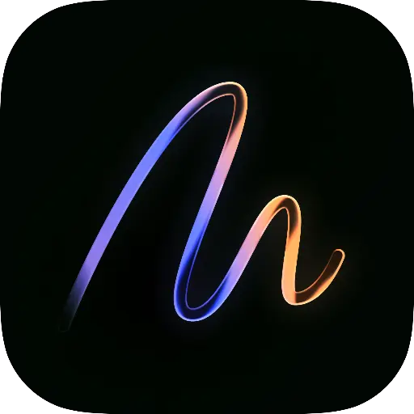

# NotchPad

Rich notes, clipboard history and reusable snippets for Mac — in a full desktop workspace, your notch, or sticky notes beside your work.

**NotchPad 1.9.1 · Apple silicon · macOS 15 or later · No notch required**

[Download NotchPad](https://notchpad.app/download) · [14-day trial and pricing](https://notchpad.app/pricing) · [Release notes](https://notchpad.app/releases)

## One library, three ways to work

- **Desktop workspace:** open notes in tabs, edit in split panes, and return to pinned or recent notes from the sidebar. Folders remain available for projects and topics.
- **Notch widget:** open Notes, Clipboard or Snippets with double Control, the menu bar, or a hover. Switch back to the workspace when you need more room.
- **Window stickies:** attach notes to an app, a window, or a supported browser page or Figma file. Move, resize, stack, hide and restore them beside their work. Window tracking requires Accessibility permission.

## Write, find and reuse

- Rich text with headings, font controls, links, images, editable tables and interactive checklists.
- Searchable clipboard history for text, links and supported media; star useful items and merge copied text.
- Named snippets for replies, prompts, commands and other text you paste repeatedly.
- Command-K searches notes, clipboard items, snippets, settings and actions; Escape closes the palette.
- Paper, Beige, Charcoal and Midnight workspace themes, with optional background transparency.

## Keep control of your data

Export password-protected backups of rich notes, embedded images, folders and snippets, with optional clipboard history. Import on another Mac or merge without replacing existing items. Individual notes support rich-text document import and export.

Use the eye button to hide body contents across the workspace, widget and stickies. Revealing them requires Touch ID or your Mac password. Individually locked notes are encrypted and keep their own authentication. Workspace notes stay unlocked while their tabs remain open.

## Connect AI apps, or use local AI

Set up Claude, Codex, Cursor, VS Code or another MCP client inside AI Connections. Choose shared folders and give each connection read and write permissions. Writes create or append notes; they do not reorganize or delete existing notes or folders. Locked notes, Apple Notes links and clipboard history are excluded from MCP.

Built-in rewriting, summaries, translation and folder suggestions use Apple Intelligence on supported Macs with macOS 26 or later. Connected AI apps use their own accounts and providers. Voice capture opens the separate NotchLive app and requires NotchLive Pro.

## Trial and Pro

Start a **14-day full-access trial**, with no card and no automatic charge. NotchPad Pro is **$9.99 once for up to 3 Macs**. Existing Pro licenses keep their access.

Without an active trial or Pro license, saved content remains readable, copyable and exportable. Creating and editing, new clipboard capture, imports and AI writing require trial or Pro access. The Welcome Note remains editable so you can try the editor before starting the trial.

## Install

1. Download the [latest signed and notarized DMG](https://github.com/lemberalla/notchpad-releases/releases/latest).
2. Drag NotchPad into Applications and launch it.
3. Explore the editable Welcome Note, then start your 14-day trial when you are ready.
4. Use the desktop workspace, or open the notch widget with double Control.

Support: [support@tinythings.app](mailto:support@tinythings.app) · [Privacy](https://notchpad.app/privacy)
